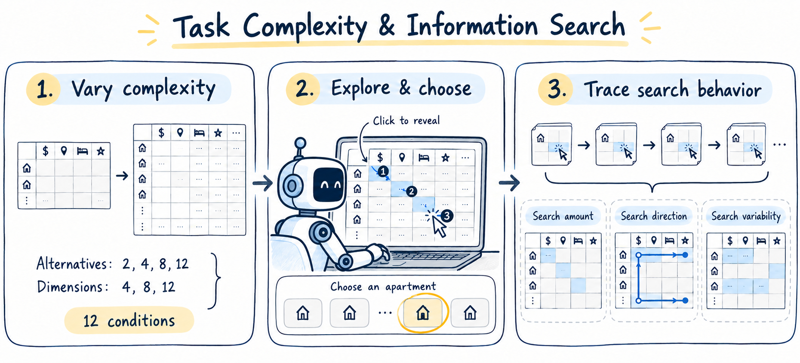
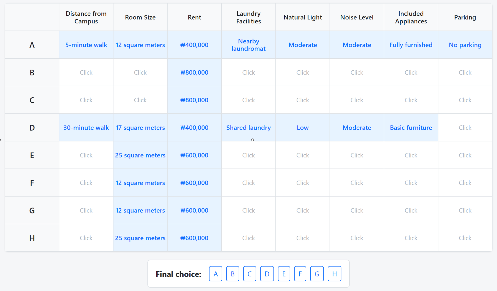

# Task-Complexity

**How Task Complexity Shapes Information Search Patterns in Agents for Computer Use**

Seungju Lee · Minchul Cha · Hankuk University of Foreign Studies<br>
HAI ’26 · November 16–19, 2026 · Osaka, Japan

[Paper](https://doi.org/10.1145/3841580.3845692) · [Experiment](docs/experiment/README.md) · [Agents](agents/README.md) · [Analysis](analysis/README.md) · [Citation](paper/README.md#citation)



## Overview

A web-based information-board experiment for studying how AI agents explore information before choosing an apartment. The task crosses **2/4/8/12 alternatives × 4/8/12 dimensions**, producing **12 conditions**.

The code provides click-to-reveal information cells, six agent integrations, shared behavioral logging, agent traces, and search-pattern analysis.



## Quick Start

With Python 3.10+ and the dependencies in `requirements.txt` installed:

```bash
python app.py
```

Open **http://localhost:5000**. Enter a participant ID and select a condition. See [web setup](docs/experiment/README.md) for installation and [agent setup](agents/README.md) for Docker and API keys.

## Components

- [Experiment](docs/experiment/README.md): interface, conditions, and event logs.
- [Agents](agents/README.md): six implementations and execution commands.
- [Analysis](analysis/README.md): Search Index, ARC, and action classification.
- [Cost configuration](costs/README.md): enter your own model prices.
- [Documentation](docs/README.md): settings, batch runners, and development tools.
